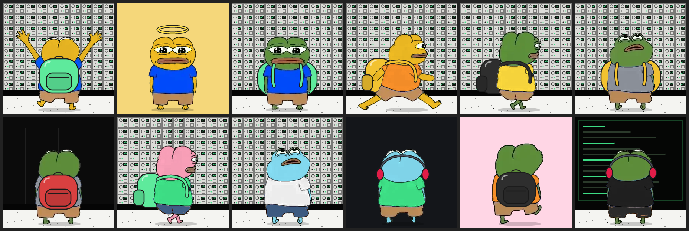

# Pepes Family

**Launch page:** open `index.html` from this repo's website (GitHub Pages) in the browser that has your wallet extension.



3,333 Pepes on Robinhood Chain (chain 4663), drawn from **IMD's own Pepe** (the character on [imd.fun](https://imd.fun),
used at the IMD team's request) and **fully on chain**: IMD's 19 poses are stored in contract code, and a contract
draws every NFT's picture (an SVG) and writes its traits. No IPFS, no server: nothing can go missing.

Each Pepe is IMD's drawing in one of its 19 poses (front, side, from behind, walking, running, scratching its head,
looking up, cheering), with its skin, shirt and shorts recoloured by SVG filters (colour-keyed masks that keep IMD's
lines and shading), a background (the IMD panel wall, the terminal, the floor, or a colour) and maybe headphones, a halo or shades.

The mint, commit-reveal, royalty enforcement and links are I'M DEGEN's
([AdamNakamoto/MineWorld](https://github.com/AdamNakamoto/MineWorld)).

| | |
|---|---|
| Name / symbol | Pepes Family / Pepes |
| Supply | 3,333, no two alike (four 1/1s: Genesis, The Swarm, Golden Pepe, Night Shift) |
| Traits | Pose (19), Skin (7), Shirt (9), Shorts (6), Background (10), Extra (4) |
| Price | 0.000413 ETH ($1 at ETH $2,424, 2026-10-18); the owner can change it with `setPrice` |
| Wallet limit | 3 per wallet (owner can set 1 to 50); wallets only, no contracts |
| Owner | `0x3c8A4d94B3219F6633F2cC94094f4765b30c691C` (can never be renounced, so OpenSea Studio always works) |
| Treasury | the same address: all mint money, straight away, and the 5% royalty |
| Royalty | 5%, fixed, enforced with ERC721-C through OpenSea's registry (`0xA000…0000`): marketplaces must pay it; holders can always move their own Pepes |
| Editable later | `setLinks(website, x)`, `setDescription`, `setCollectionImages(image, banner)`, `setPrice`, `setWalletLimit`: any time, sold out or not |

## Contracts

| File | What it is |
|---|---|
| `src/PepesFamily.sol` | The NFT (ERC-721 + ERC-2981 + ERC721-C). Blind mint, then reveal: a keyed shuffle from a seed nobody can know early assigns each token one of the 3,333 trait sets |
| `src/ImdPepeArt.sol` | Draws each picture (background, the recoloured pose, a shadow, the extra) and writes the traits (generated) |
| `src/ImdPepeData0.sol` ... `ImdPepeData6.sol` | IMD's 19 frames as WebP (140 KB in all), as contract code (generated) |
| `src/ImdPepeParts.sol` | The text the pictures are made of: trait names, colour matrices, backgrounds, extras (generated) |
| `src/ImdPepeSpecs.sol` | The 3,333 trait sets, 4 bytes each (generated) |

`art/imd/` holds IMD's sprite sheet and the 19 frames cut from it (with their measurements: crop, head, eyes).
`tools/gen_imd_art.py` turns them, and the trait tables in it, into the generated contracts (from
`tools/imd_art_template.sol`); don't edit the generated files.

## Checks

```
forge build && forge test                      # 16 tests: mint, payments, limits, sell-out, reveal, royalty, links,
                                               # owner-only, every trait set unique and every trait used, every pose renders
python3 tools/gen_imd_art.py --check           # the generated contracts match art/imd and the trait tables
forge script script/Preview.s.sol              # writes build/preview/<n>.svg and .json as the chain draws them
```

## Launch (from the owner wallet, in your browser)

1. Install [Foundry](https://getfoundry.sh) 1.5 or later (`foundryup`; `--browser` needs it), Python 3 and Node, then
   `npm install` in this folder (OpenZeppelin 5.1.0). Put a little ETH on Robinhood Chain in the owner wallet for gas.
2. Dry run (sends nothing): `./script/deploy.sh --browser`
3. Deploy: `WEBSITE=https://... X_LINK=https://x.com/... ./script/deploy.sh --broadcast --browser` (links optional).
   It stops at each transaction with **">> Approve ... at http://127.0.0.1:9545"**: open http://127.0.0.1:9545 in
   your browser, connect the owner wallet (`0x3c8A…691C`) on Robinhood Chain and approve; refresh the page for the next
   one (11 deploys: the trait sets, the picture parts, 7 frame contracts, the art, the NFT; plus one each for the links
   and opening the mint if you set them). After the first deploy it checks the
   connected wallet is the owner and stops if not.
   It writes the reveal secret to `~/pepes-family-reveal-secret.txt`: **back it up**; without it the Pepes can never be
   revealed. The addresses go to `deployments/chain-4663.json`.
4. OpenSea Studio: sign in with the owner wallet, turn on creator earnings at 5%, add the description, logo, banner and links.
5. Open the mint: `cast send <PepesFamily> "setSaleOpen(bool)" true --browser --browser-disable-open --rpc-url https://rpc.mainnet.chain.robinhood.com`
   (approve at http://127.0.0.1:9545).
6. After the mint: announce the reveal time, then `BROWSER=1 ./script/reveal.sh` (approve the sale close, the reveal and
   the seal at http://127.0.0.1:9545; the seal must land within ~26 seconds of the reveal, so keep the page open; anyone
   can also seal with `./script/reveal.sh --seal-only`). Every Pepe's look then shows, for everyone at once.

Change links later: `cast send <PepesFamily> "setLinks(string,string)" "https://site" "https://x.com/handle" --browser --browser-disable-open --rpc-url https://rpc.mainnet.chain.robinhood.com`

Prefer a keystore to the browser? `cast wallet import pepes-owner --interactive` once, then the same commands without
`--browser` (the scripts use `--account pepes-owner`).
